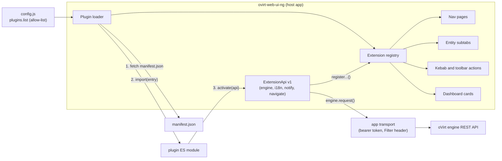

# ADR-0001: UI extensions and the Cockpit host console

- **Status:** Proposed
- **Issue:** skywalkw3r/ovirt-web-ui-ng#13
- **Scope of the pull request that adds this ADR:** this document plus the
  in-tree Cockpit host console (section 7). The extension API itself
  (sections 1 to 6) is design only and ships in follow-up pull requests.

## Context

The GWT Administration Portal lets a deployment add main tabs, detail
subtabs, toolbar buttons and dialogs at runtime through its `pluginApi`. The
best-known plugin gave every host a "Host Console" that opened the host's
Cockpit web console. This console has no extension mechanism: every tab and
action is compiled in.

We want deployments to add their own tabs, actions and panels without forking
the app. We do **not** want to emulate the legacy `pluginApi` (iframes,
`postMessage`, global callbacks), and we do not want a marketplace or
install-from-the-UI flow.

A plugin is code running inside an administrator's console session, so the
security model drives most of the decisions below.

## Decision summary

| Topic            | Decision                                                                                             |
| ---------------- | ---------------------------------------------------------------------------------------------------- |
| Who may load     | Only plugins named in the deployment's `config.js` (allow-list). Default: none.                      |
| Manifest         | One small JSON file per plugin, fetched from the allow-listed URL.                                   |
| Loading          | Native ES modules through dynamic `import()`. No module federation.                                  |
| Shared libraries | React and PatternFly come from the host app, not from the plugin bundle.                             |
| API              | A typed, versioned `ExtensionApi` object passed to the plugin's `activate()` function.               |
| Engine access    | Through the app's transport only (same token, same `Filter` RBAC). No plugin credentials.            |
| CSP              | Same-origin plugins need no change. Other origins are added to `script-src` one by one.              |
| Failure          | Load, activation and render errors are contained per plugin and per contribution.                    |
| Multi-engine     | Plugins belong to the console deployment, not to an engine. They always talk to the session's engine. |
| Feature flag     | Off unless `plugins.enabled` is true in `config.js`.                                                 |

## How it fits together



An analogy: the host app is a power strip. The allow-list decides which
appliances may be plugged in, the manifest is the label on the plug, and the
`ExtensionApi` is the socket shape. Appliances draw power (engine data)
through the strip, never by wiring themselves to the mains.

## 1. Manifest and allow-list

The allow-list lives in `config.js`, the same deployer-owned, server-side
file that already controls the engine list. A user cannot add a plugin from
the browser.

```js
// config.js
plugins: {
  enabled: true,
  list: [
    { name: 'acme-backup', manifest: '/plugins/acme-backup/manifest.json' },
    { name: 'site-links', manifest: 'https://plugins.example.com/site-links/manifest.json' },
  ],
},
```

```json
{
  "name": "acme-backup",
  "version": "1.4.0",
  "displayName": "ACME Backup",
  "apiVersion": 1,
  "entry": "./index.js"
}
```

Rules:

- `name` in the manifest must equal the allow-list entry's `name`. A mismatch
  rejects the plugin.
- `manifest` is a same-origin path or an absolute `https` URL. Validation
  follows `config/runtime.ts` (no `javascript:`, no protocol-relative URLs, no
  plaintext `http` to another origin).
- `entry` resolves relative to the manifest URL and must stay on the
  manifest's origin.
- `apiVersion` is the major version of the extension API the plugin was built
  for (section 3).
- The manifest is parsed with a zod schema, like every other trust boundary in
  the app. Unknown keys are ignored.

Removing a plugin from the list removes it from the UI on the next page load.
There is no persisted plugin state in the host app.

## 2. Loading: dynamic `import()` versus module federation

| Criterion              | Dynamic `import()` (chosen)                                    | Module federation                                         |
| ---------------------- | -------------------------------------------------------------- | --------------------------------------------------------- |
| Build tooling          | None in the host. Plugins are plain ES modules.                | A federation plugin in the host and in every plugin build. |
| Coupling               | Only the typed API object.                                     | Shared dependency graph and version negotiation at runtime. |
| CSP                    | `script-src` origins only. No `eval`.                          | Same, but the runtime container adds moving parts to audit. |
| Shared React/PatternFly | Host hands them to the plugin (see below).                    | Declared as shared singletons.                             |
| Failure isolation      | A rejected promise per plugin.                                 | Container init failures are harder to attribute.           |
| Plugin author effort   | Small Vite preset from the SDK.                                | Must match the host's federation setup exactly.            |

**Decision:** dynamic `import()`. It keeps the host build unchanged, has the
smallest surface to audit, and matches the app's existing use of dynamic
import for the mock engine and lazy locale catalogs.

**Shared libraries.** Two copies of React on one page break hooks and
context, and two copies of PatternFly break theming. Plugins therefore do not
bundle them. The host exposes its own instances through a frozen shared-module
table that is filled before any plugin loads. The plugin SDK ships a Vite
preset that rewrites `react`, `react-dom`, `react/jsx-runtime`,
`@patternfly/react-core`, `@patternfly/react-table` and
`@patternfly/react-icons` imports to that table. A plugin author writes
ordinary React and PatternFly 6 code and gets the app's theme (light and
dark) for free.

**Order of operations at boot** (after sign-in, so nothing loads for an
anonymous visitor):

1. Read `plugins` from the runtime config. If disabled or empty, stop.
2. Fetch each manifest (in parallel, with a timeout) and validate it.
3. `import()` each entry module (in parallel, with a timeout).
4. Call `activate(api)` for each plugin inside a `try`/`catch`.
5. Contributions appear as their registrations arrive. The shell never waits
   for plugins to render its own pages.

**Integrity (open question).** `import()` has no integrity argument. An
optional `integrity` hash on the allow-list entry could be enforced by
preloading the entry with `<link rel="modulepreload" integrity="...">` before
importing it. This needs a browser-support check during implementation and is
not part of API v1 unless that check passes.

## 3. API surface and versioning

A plugin's entry module exports one function:

```ts
import type { ExtensionApi } from '@ovirt-web-ui-ng/extension-api'

export function activate(api: ExtensionApi): void {
  api.registerEntityTab({
    entity: 'host',
    id: 'backup',
    title: api.i18n.message('acme.backup.tab'),
    component: BackupTab, // receives { entity: Host }
    isVisible: ({ capabilities }) => capabilities.isAdmin,
  })
  api.registerAction({
    entity: 'vm',
    id: 'backup-now',
    label: api.i18n.message('acme.backup.now'),
    placement: ['kebab', 'toolbar'],
    isVisible: ({ entity }) => entity.status === 'up',
    run: ({ entity }) => api.engine.request(`/vms/${entity.id}/...`, { method: 'POST' }),
  })
}
```

Version 1 extension points:

| Method                  | Adds                                                         |
| ----------------------- | ------------------------------------------------------------ |
| `registerNavPage`       | A page in the main navigation, with its own route.           |
| `registerEntityTab`     | A subtab on a detail page (VM, host, cluster, storage domain, network, data center, template, disk). |
| `registerAction`        | An item in an entity's kebab menu and/or list toolbar.       |
| `registerDashboardCard` | A card on the dashboard.                                     |

Version 1 services:

| Service         | Purpose                                                                               |
| --------------- | ------------------------------------------------------------------------------------- |
| `api.engine`    | `request(path, options)` through `api/transport.ts`. The plugin never sees the token. |
| `api.i18n`      | Current locale, and registration of the plugin's own message catalogs.                |
| `api.notify`    | Toasts and the notification drawer.                                                   |
| `api.navigate`  | Typed navigation to app routes.                                                       |
| `api.session`   | Read-only: user name, capability tier, active engine name.                            |
| `api.version`   | `{ api: 1, app: '<console version>' }`.                                               |

Versioning rules:

- The API has an integer major version. The manifest's `apiVersion` must be
  one the host supports, otherwise the plugin is rejected with a clear message.
- Within a major version, changes are additive only.
- A breaking change raises the major version. The host keeps the previous
  major working for at least one minor release of the console and logs a
  deprecation notice for plugins still on it.
- The TypeScript types are the contract. They live in this repository
  (`app/src/extensions/api.ts`) and are published as
  `@ovirt-web-ui-ng/extension-api` from the same release pipeline, so the
  types cannot drift from the implementation.
- Contribution ids are namespaced by plugin name (`acme-backup:backup-now`),
  so two plugins cannot collide.

Everything not in the tables above is private. Plugins must not import app
internals or reach into the DOM of the shell.

## 4. Security

**Trust model, stated plainly.** A loaded plugin runs in the same JavaScript
realm as the app. The API keeps the token out of the plugin's hands by
design, but it is not a sandbox: a malicious plugin could read
`sessionStorage` or patch `fetch`. Allow-listing a plugin is therefore the
same trust decision as deploying a build of the console. The controls below
make sure only the deployer can make that decision, and that an honest plugin
cannot widen the attack surface by accident.

| Control            | Mechanism                                                                                                   |
| ------------------ | ----------------------------------------------------------------------------------------------------------- |
| Allow-list         | Only `config.js` entries load. No UI to add plugins, no URL parameters, no engine-supplied plugin lists.     |
| CSP                | `script-src 'self'` already covers plugins served from the console origin (the recommended layout, under `/plugins/`). Each other origin is enumerated in `script-src`, never a bare `https:`. `connect-src` does not change, because plugins call the engine through the app. |
| Credentials        | `api.engine.request` adds the bearer token and the `Filter` header itself. Plugins store no credentials and callers cannot override either header. |
| RBAC               | The engine enforces permissions server-side, exactly as for built-in pages. `isVisible` is a convenience, not a control. |
| No inline or eval  | `script-src` keeps no `'unsafe-inline'` and no `'unsafe-eval'`. A plugin that needs them does not load.      |
| Rendering          | Plugin components are React elements. `dangerouslySetInnerHTML` stays banned by convention and review.      |
| Transparency       | The About dialog lists loaded plugins with name, version and origin, and any that failed.                   |

**CSP wiring** follows the multi-engine pattern in
[SECURITY-HEADERS.md](SECURITY-HEADERS.md): a `CSP_SCRIPT_EXTRA` variable for
container and OpenShift deployments, substituted into both the response
header and the `<meta>` policy so they cannot drift. Empty by default, which
keeps today's policy byte for byte.

**Alternative considered: iframe sandbox per plugin.** It gives real
isolation, but plugins could not render PatternFly components inside the
app's tables, menus and detail pages, could not follow the theme, and would
need a `postMessage` protocol, which is the legacy model we are leaving
behind. Rejected for API v1.

## 5. Error isolation

| Failure                               | What the user sees                                                    | What the shell does                                      |
| ------------------------------------- | --------------------------------------------------------------------- | -------------------------------------------------------- |
| Manifest missing, invalid or mismatched | Nothing in the UI. Entry marked failed in the About dialog.          | Logs a warning naming the plugin. Other plugins continue. |
| Entry module fails to load or times out | Same.                                                                | Same.                                                    |
| `activate()` throws                   | Same. Registrations made before the throw are rolled back.            | Same.                                                    |
| A contributed component throws on render | An inline error state in that tab, card or page, naming the plugin. | A React error boundary around every contribution.        |
| An action's `run` rejects             | An error toast naming the plugin.                                     | The menu and page keep working.                          |

A broken plugin must never blank the shell, block sign-in or delay built-in
pages.

## 6. Multi-engine mode

In multi-engine builds (`servers/registry.ts`) one console talks to several
engines, one per session.

- **Plugins belong to the console deployment.** The allow-list is global, and
  plugin origins are independent of the engine list. Plugin code is never
  loaded from an engine origin just because the engine is listed.
- **Engine calls follow the session.** `api.engine.request` uses the same
  base as the app's transport (`getRequestBase`), so a plugin always talks to
  the engine the token belongs to and cannot target another one.
- **Per-engine plugins.** An allow-list entry may carry an optional
  `servers: ['HE 1']` filter (names from `servers.list`). Without it the
  plugin loads for every engine.
- **Integrated RPM build.** Single engine; plugins are served from
  `/ovirt-engine/web-ui-ng/plugins/` on the engine host and need no CSP
  change.

## 7. Cockpit host console (shipped with this ADR)

The host console is the first consumer. It is built in-tree now and moves
onto `registerEntityTab` and `registerAction` once those exist, which proves
the API against a real feature.

What ships:

- A `Host console` item in the shared host menu (list kebab, right-click
  menu, infrastructure tree, cluster host tables).
- A `Host console` tab on the host detail page that explains what will happen
  and opens the console.
- Always a new browser tab, opened with `noopener,noreferrer`.
- **Direct mode** (default): `https://<host address>:9090`, with a note that
  Cockpit asks for a host account and may raise a certificate warning.
- **SSO mode** (opt-in): the legacy `ovirt-cockpit-sso` handoff,
  `https://<engine>:9986/=<host id>/machines#access_token=<token>`, only to an
  `https` origin the deployer configured, and per engine in multi-engine mode.

Details, configuration and the certificate guidance are in
[HOST-CONSOLE.md](HOST-CONSOLE.md).

Why SSO is opt-in: the handoff gives the session token to another web
service, and current engine releases generally no longer ship that service.
A default that silently did nothing, or sent a token somewhere unexpected,
would be worse than a clear direct link.

**Embedding is deferred.** Showing Cockpit inside a host detail tab would
need `frame-src` in the CSP (today the app frames nothing), host-side changes
so Cockpit accepts being framed by the console origin, and a security review
of mixing a second authenticated origin into the page. The tab added here is
where an embed would go if that review passes.

## Rollout

| Step | Content                                                                                     | Status            |
| ---- | ------------------------------------------------------------------------------------------- | ----------------- |
| 1    | This ADR                                                                                    | This pull request |
| 2    | Cockpit host console, in-tree                                                               | This pull request |
| 3    | Extension registry, loader and the four extension points behind `plugins.enabled`; sample plugin; unit and e2e tests | Follow-up |
| 4    | Move the host console onto the API; plugin author and deployment guide                      | Follow-up         |

## Consequences

- Deployments gain a supported way to add UI without forking.
- The extension API becomes a compatibility promise that needs tests and
  release notes.
- Built-in detail pages and menus must render contributions from the registry,
  which touches each entity page once.
- Plugin authors depend on the host's React and PatternFly major versions. A
  major upgrade of either is an extension API major version.

## Open questions

1. Integrity pinning for entry modules (section 2).
2. Should `registerNavPage` allow nesting under existing nav groups, or only a
   dedicated "Extensions" group?
3. Do plugins need a per-plugin settings store, or is `config.js` enough?
4. Publishing: is the types package released to npm, or consumed from a
   release artifact?
